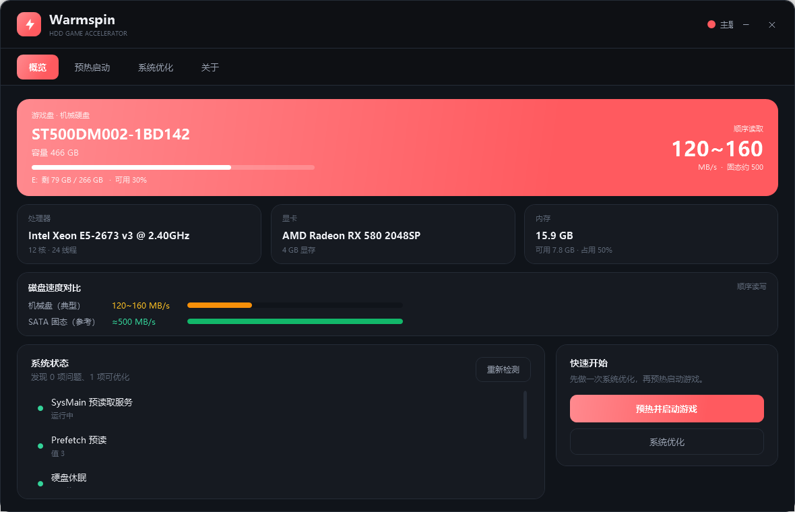
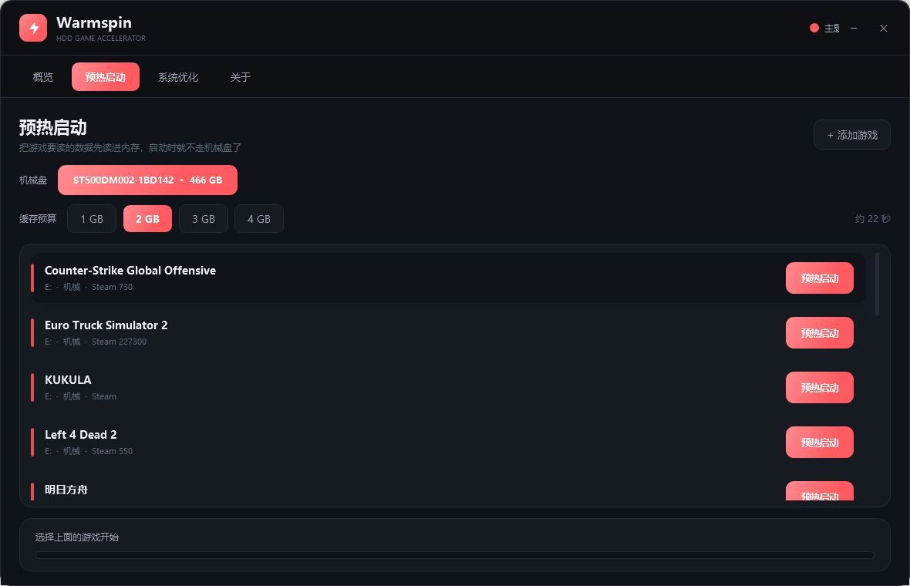
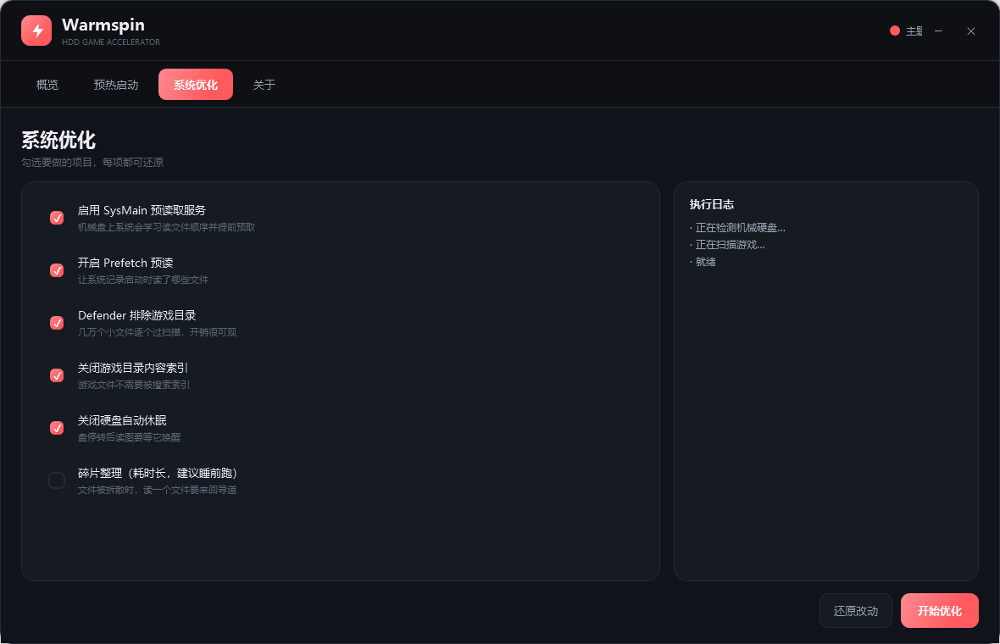
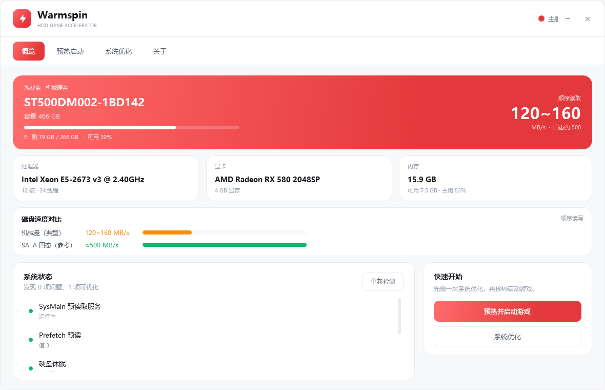
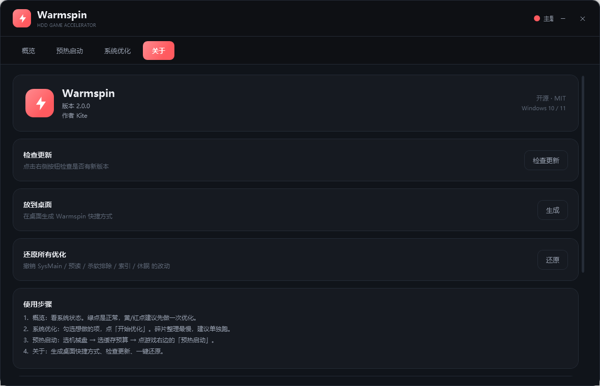

# Warmspin · HDD Game Accelerator

给装在机械硬盘上的游戏做加载优化。**不是**把机械盘变成固态盘的魔法——那件事任何软件都做不到。

一个 472 KB 的原生 Windows 桌面程序（C# / WPF / .NET Framework 4.x）：不需要 .NET SDK、不需要运行时安装包、没有控制台窗口。

作者 **Kite** · MIT 协议



## 先说清楚：能做什么，不能做什么

| | |
|---|---|
| ✅ 能做 | 修好被"优化软件"关掉的 SysMain 预读、把游戏目录排除出杀软实时扫描、关掉内容索引、避免硬盘休眠、整理碎片，并把**本次加载要读的数据提前读进内存** |
| ❌ 做不到 | 让机械盘的随机读取追上固态盘。机械盘随机 4K 约 0.5~1 MB/s、寻道 12 ms；SATA SSD 随机 4K 约 40 MB/s、寻道 0.1 ms。游戏加载以小文件随机读为主，这段差距是物理限制 |

实测参考（7200 转 500G 机械盘，70% 占用）：顺序读 85 MB/s，预热读入 95~125 MB/s；同价位 SATA SSD 顺序约 500 MB/s。

真正想接近固态：**把游戏装到 SSD 上**。这个工具解决的是"暂时换不了盘"的情况。

## 功能



### 1. 预热启动

游戏读图要从盘上读 1~3 GB。程序在启动游戏**之前**把这些数据读进 Windows 备用内存（standby list），游戏真启动时读它们走内存而不是机械盘。

- 缓存预算 1/2/3/4 GB 可选，**严格不超预算**：单个文件比剩余预算大就跳过，避免"预算 2 GB 却读了 9 GB"
- 游戏行左侧有强调色竖条，右侧是一键「预热启动」
- Steam 游戏通过 `steam://rungameid/<appid>` 拉起（直接跑 exe 会缺 Steam 环境）

### 2. 多机械盘检测与选择

自动检测机器上所有机械硬盘（WMI `MSFT_PhysicalDisk` 的 `MediaType`），在预热页顶部列出「型号 · 容量」：

- 只有一块盘时就是一个静态标签
- 多块盘时点一下切换，**游戏列表只显示该盘上的游戏**，概览页的磁盘卡片也跟着切
- 一块都没检测到时，会自动提示去「+ 添加游戏」手动指定

### 3. 系统优化（六项，全部可还原）

| 项目 | 说明 |
|---|---|
| 启用 SysMain | 机械盘上它有用：系统会学习读文件顺序并提前预取 |
| 开启 Prefetch | 让系统记录启动时读了哪些文件 |
| Defender 排除 | 几万个小文件逐个过实时扫描，开销可观 |
| 关闭内容索引 | 游戏文件不需要被搜索索引 |
| 关闭硬盘休眠 | 盘停转后读图要等它唤醒 |
| 碎片整理 | 文件被拆散时读一个文件要来回寻道（默认不勾，可能几十分钟） |



### 4. 游戏发现

自动扫三个来源并去重：Steam 库（解析 `libraryfolders.vdf` 拿 AppID）、桌面/开始菜单快捷方式（解析 .lnk 目标并上跳到游戏根目录）、注册表安装项（`InstallLocation`）。

扫不到就点「+ 添加游戏」手动选目录，记在 `custom.txt` 里。

### 5. 主题切换

四种配色，右上角「主题」切换，选择会记住：

| 红黑（默认） | 红白 | 靛蓝 | 青竹 |
|---|---|---|---|
| 深色 + 红 | 白底 + 红 | 白底 + 蓝 | 白底 + 绿 |



### 6. 自动更新

读远端 `update.json` 比对版本，下载后校验 SHA-256，再"改名旧 exe → 拷入新 exe → 重启"。不需要额外的更新器进程，也不受中文路径影响。

## 构建

需要 Windows + .NET Framework 4.x（Win10/11 自带），**不需要** Visual Studio / .NET SDK。

```powershell
# 正式版（内嵌 requireAdministrator 清单）
powershell -ExecutionPolicy Bypass -File build.ps1

# 调试版（不要管理员权限，改界面时用）
powershell -ExecutionPolicy Bypass -File build.ps1 -NoManifest
```

产物：`dist\Warmspin.exe`

构建脚本直接调用系统自带 `csc.exe`，引用 GAC 里的 WPF 程序集，XAML 作为嵌入资源打包，图标作为 win32 资源嵌入。

## 使用

双击 `Warmspin.exe`（会请求管理员权限，因为要改服务/注册表/Defender 排除项）。

| 页面 | 内容 |
|---|---|
| **概览** | 游戏盘概览、CPU/显卡/内存、磁盘速度对比、系统状态检查、快速入口 |
| **预热启动** | 机械盘选择 + 游戏列表 + 缓存预算 + 实时进度 |
| **系统优化** | 六个开关 + 执行日志 + 还原 |
| **关于** | 版本、作者、检查更新、桌面快捷方式、还原，以及**使用步骤 / 常见问题** |



命令行参数：

```
Warmspin.exe --page=warm|tune|about|overview   # 直接打开某页
Warmspin.exe --theme=redblack|red|blue|green   # 指定主题启动
Warmspin.exe --shot=out.png                    # 渲染窗口截图后退出（做文档用）
```

## 配置自动更新

1. 把 `update.json` 放到任意可访问的 HTTPS 地址：

```json
{
  "version": "2.1.0",
  "url": "https://example.com/Warmspin.exe",
  "sha256": "下载文件的 sha256（小写十六进制）",
  "notes": "本次更新说明"
}
```

2. 修改 `src/Updater.cs` 里的 `ManifestUrl`，重新构建。

未配置时「检查更新」会明确提示"未配置更新源"，不会假装成功。

## 附：GitHub 访问优化

仓库带了一个 `tools/github-hosts.ps1`：测几个 GitHub 节点，把最快的写进 hosts 并清 DNS 缓存。

```powershell
# 右键 → 以管理员身份运行，或：
powershell -ExecutionPolicy Bypass -File tools/github-hosts.ps1

# 还原（用备份 hosts.warmspin.bak 覆盖回去）
powershell -ExecutionPolicy Bypass -File tools/github-hosts.ps1 -Restore
```

写入前会备份 `hosts.warmspin.bak`，只追加 `# warmspin-start` 到 `# warmspin-end` 之间的几行，不碰其它内容。

**要说明的是**：国内多数线路到 GitHub 是被限速（实测 11~29 KB/s），改 hosts 只能挑到相对快的节点，
不能把限速变没。clone 大仓库仍然会很慢，那需要代理。

## 目录结构

```
build.ps1              构建脚本（调用 csc.exe）
src/
  Program.cs           入口：加载内嵌 XAML、显示窗口、--shot 渲染
  MainWindow.cs        界面逻辑：列表渲染、事件、优化/预热/更新流程
  Theme.cs             配色方案 + 运行时换肤
  Updater.cs           自动更新（检查/下载/校验/替换重启）
  Ui.xaml              界面（嵌入资源，运行时解析）
  Engine.Sys.cs        硬件信息、磁盘检测、系统设置（WMI + P/Invoke + 注册表）
  Engine.Games.cs      游戏发现、Steam AppID、配置存档
  Engine.Warm.cs       预热引擎、启动器
  Engine.Optimize.cs   六项优化动作 + 还原
  app.manifest         要求管理员权限、DPI 感知
assets/icon.ico        程序图标
docs/                  截图
tools/github-hosts.ps1 GitHub 访问优化
legacy/                最初的 PowerShell 版本，仅作参考，不再维护
```

## 已知限制

- 仅 Windows（WPF）
- 需要管理员权限
- 预热只对"数据能被内存装下"的情况有效
- 游戏发现基于启发式（快捷方式、注册表、名称黑名单），不保证覆盖所有游戏；漏了请手动添加
- 只在 Windows 10 22H2 上实测过

## 下载站

`website/` 是一个纯静态网站（无后端、无外部依赖），包含首页、截图和下载文件：

`
website/
  index.html          首页
  assets/             截图
  download/Warmspin.exe   下载的 exe
  README.md           部署说明（GitHub Pages / 静态托管）
`

部署方式见 [website/README.md](website/README.md)。最简单的路径是推到 GitHub 后开 Pages，
目录选 `/website`。仓库根目录的 `update.json` 是自动更新清单模板，填好 URL 与 sha256 后
把 `src/Updater.cs` 里的 `ManifestUrl` 指过去即可。

## 协议

MIT，见 [LICENSE](LICENSE)。Copyright (c) 2026 Kite.
